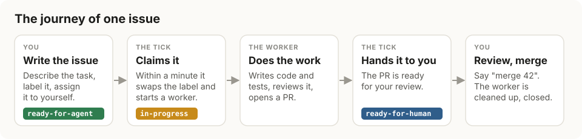
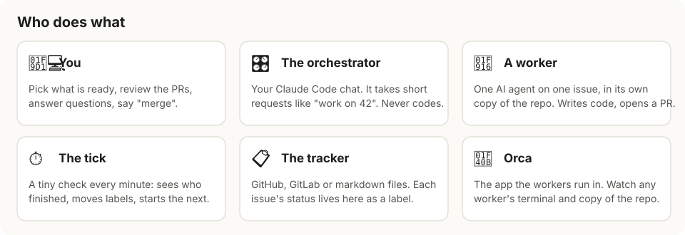
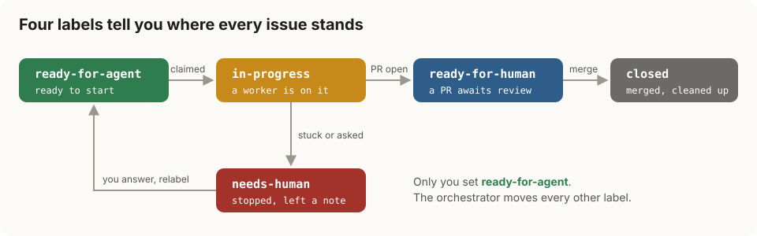
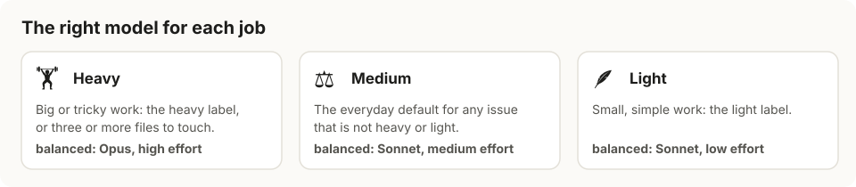

# orchestrator-skills

**Hand an issue to an AI agent, and get a pull request back.**

You keep a list of issues in your tracker. Some are small, clear tasks an agent could do on
its own. Mark one as ready, assign it to yourself, and a minute later an agent starts on it,
in its own private copy of the repo. When it is done, it opens a pull request. You review
it like a colleague's, and you say when to merge.

For a friendly, illustrated tour, open [`docs/how-it-works.html`](docs/how-it-works.html)
in a browser.

Version 1 is still available at the
[`v1.0.0`](https://github.com/wagnersza/orchestrator-skills/tree/v1.0.0) tag.



> **Think of it like a small team.** You are the lead who decides what gets done and
> approves the result. The agents are helpers who each take one task. A clock on the wall
> checks on everyone once a minute. The tracker is the shared whiteboard where everyone can
> see who is doing what.

## Why use it

- **Waiting is free.** The once-a-minute check is a plain script, not an AI, so nothing is
  spent while the agents work.
- **Your chat stays yours.** "work on 42" answers right away. Keep talking about anything
  else while up to three agents work in parallel.
- **The right model for each job.** A one-line fix does not need your most expensive
  model. Each issue gets a heavy, medium or light setup, picked by simple rules.
- **Five agent tools to choose from:** claude, codex, cursor, pi and copilot. Mix them, for
  example Claude Opus for heavy work and Codex for light work.
- **Your tracker is the dashboard.** GitHub, GitLab or plain markdown files. Each issue's
  status is one label, and nothing else, so nothing can drift out of sync. If something
  crashes, the next check simply picks up where the last one stopped.
- **A stuck agent stops and asks.** It does not keep guessing. It leaves you a comment with
  its question, and a fresh agent continues once you answer.
- **Whole stories, in order.** Split a feature into child issues, and each one starts as
  soon as what it depends on is done.
- **You stay in charge.** You decide what is ready, you review every PR, and nothing merges
  until you say so.
- **Small.** One TypeScript script with no runtime dependency, and two skills.

## Who does what



- **You** pick what is ready, review the pull requests, answer questions and say "merge".
- **The orchestrator** is your Claude Code chat. It understands a few short requests, such
  as "work on 42" or "status". It never writes code itself.
- **A worker** is one AI agent on one issue, in its own copy of the repo (a *worktree*,
  named after the issue, such as `issue-42`). It writes the code and the tests, and opens
  the PR.
- **The tick** is a tiny check that runs every minute. It sees who finished, updates the
  labels and starts the next issue when a slot frees up.
- **The tracker** holds every issue's status as a label.
- **Orca** is the desktop app the workers run in. You can open any worker's terminal there
  and watch it work, with the issue's page open in a tab next to it.

## The four labels

Every issue the orchestrator handles wears exactly one of four labels. Look at the label,
and you know where the issue stands.



| Label | What it means | What moves it on |
|---|---|---|
| `ready-for-agent` | Ready to start. | "work on N", or the tick once the issue is assigned to you. |
| `in-progress` | A worker is on it. | The worker reports that it is done or stuck. |
| `ready-for-human` | A PR is waiting for your review. | You merge it, by saying "merge N" or on the tracker. |
| `needs-human` | The worker stopped and left a comment saying why. | You answer on the issue and set it back to `ready-for-agent`. |

The only label you ever set yourself is `ready-for-agent`. The orchestrator moves all the
others, so the labels always tell the truth.

## What you say to it

Talk to your Claude Code chat in plain words. It knows four requests:

| You say | What happens |
|---|---|
| "work on 42" | Starts a worker on issue 42 right now, even if it is not assigned to you. |
| "status" | Shows what is running, what is next in line, and why anything else is waiting. |
| "merge 42" | Merges the PR of issue 42, cleans up its worker and closes the issue. |
| "set up the orchestrator" | Runs the setup again, to change anything. |

Or say nothing at all. Assign a ready issue to yourself, and the tick picks it up within a
minute. Issues nobody has assigned to you just wait, so nothing starts behind your back
([ADR 0006](orchestrator/docs/adr/0006-the-tick-takes-only-what-is-assigned-to-me.md)).

`node scripts/orchestrator.ts status` prints the same view as "status" from your terminal.

### When a worker gets stuck

Sometimes a task is unclear, or a test will not pass. The worker then stops, and the issue
turns `needs-human`, with a comment in the worker's own words.

1. Read the comment on the issue.
2. Reply with your answer, right there on the issue.
3. Set the label back to `ready-for-agent`.
4. A fresh worker starts in the same copy of the repo, reads your reply first and picks up
   where the last one stopped.

## The right model for each job



Each issue runs in one of three **roles**, and each role has its own agent tool, model and
effort level:

- **Heavy**, for big or tricky work: an issue with the `heavy` label, or one whose
  `## Touches` section lists three or more files.
- **Light**, for small, simple work: an issue with the `light` label.
- **Medium**, the everyday default for everything else.

The pick follows fixed rules, so it costs nothing and you can always predict it. You can
also say "work on 42 as heavy" to choose for yourself.

## Bigger work: a whole story

A big feature is often a parent issue (a "story") with smaller child issues under it. Mark
each child `ready-for-agent` and assign the parent to yourself. Each child starts as soon
as nothing it depends on is still open, so the story runs in the right order by itself.
When the last child is closed, the tick closes the parent too.

## Install

You need:

- **Claude Code**, for your orchestrator chat.
- **The Orca app**, where the workers run.
- **Node 22.18 or later.**
- **The GitHub CLI** (`gh`) for GitHub, or `glab` for GitLab. A markdown-file tracker needs
  neither.

Don't worry about installing these by hand: setup checks each one and installs what it can.

Install the plugin from your terminal:

```bash
claude plugin marketplace add wagnersza/orchestrator-skills
claude plugin install orchestrator-skills@wsza
```

Or from inside Claude Code:

```
/plugin marketplace add wagnersza/orchestrator-skills
/plugin install orchestrator-skills@wsza
```

## Set up a repo

Run setup once per repo. Running it again is always safe: it keeps everything that already
exists and only adds what is missing, so it is also how you change your answers later.

1. **Open the repo in Orca**, and start Claude Code in an Orca terminal. Setup has to run
   there, because it registers the repo with Orca.
2. **Say "set up the orchestrator".** It asks a few questions, one at a time, and always
   suggests an answer, so you can just accept:
   - **Which tracker?** It reads this from `docs/agents/issue-tracker.md`, so usually it
     does not even ask. If that file is missing, it asks you to run
     `/setup-matt-pocock-skills` first.
   - **Which cost profile?** This fills in all three roles at once:

     | Profile | Heavy | Medium | Light |
     |---|---|---|---|
     | **Balanced** (suggested) | Opus, high | Sonnet, medium | Sonnet, low |
     | **Economy** | Sonnet, high | Sonnet, low | Haiku, low |
     | **Quality** | Opus, extra high | Opus, high | Sonnet, medium |

     You can then change any single role.
   - **How many workers at once?** Three is suggested.
   - **Which branch?** The one your PRs go into, usually `main`.
3. **It installs what is missing.** The tracker tool, each agent tool your roles use, and
   the skills each worker needs to code, test, review and write a PR (`implement`, `tdd`,
   `code-review`, `diagnosing-bugs` and `pr`). If a tool needs you to log in, it gives you
   the exact command.
4. **It turns the loop on.** It saves your answers in `docs/agents/orchestrator.md`,
   creates the four labels, starts the once-a-minute check in Orca and runs one test check.
   When you see **"the precheck works"**, you are ready.

Then label an issue `ready-for-agent`, and either say "work on N" or assign it to yourself
and wait a minute.

This repo's own setup is [`docs/agents/orchestrator.md`](docs/agents/orchestrator.md). You
can edit its JSON block by hand, or re-run setup.

## Under the hood

```
orchestrator/            the orchestrator skill, its glossary and ADRs
orchestrator-setup/      the setup skill and the config template
scripts/orchestrator.ts  install · tick · start · status · merge
scripts/harnesses.ts     how each agent tool starts
scripts/trackers/        github · gitlab · local
```

The exact meaning of each term is in [`orchestrator/CONTEXT.md`](orchestrator/CONTEXT.md),
and the reasons behind each design choice are in
[`orchestrator/docs/adr/`](orchestrator/docs/adr/). `make quick` runs the typecheck and the
test suite.

## v1

v1 had cmux and herdr, a per-item automation, quality-gate layers, adversarial review and
65 ADRs. It is the [`v1.0.0`](https://github.com/wagnersza/orchestrator-skills/tree/v1.0.0)
tag.
