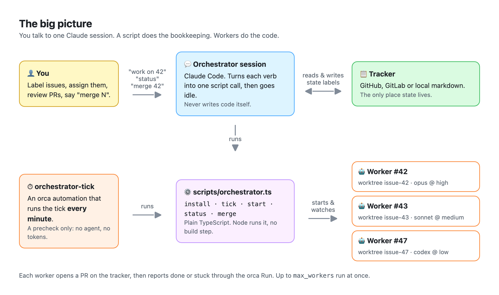
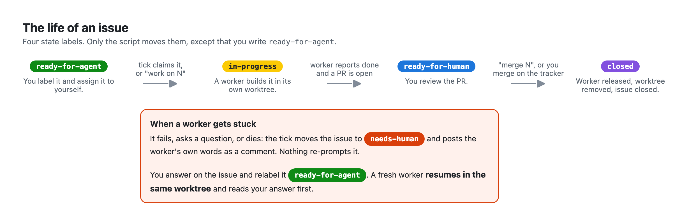
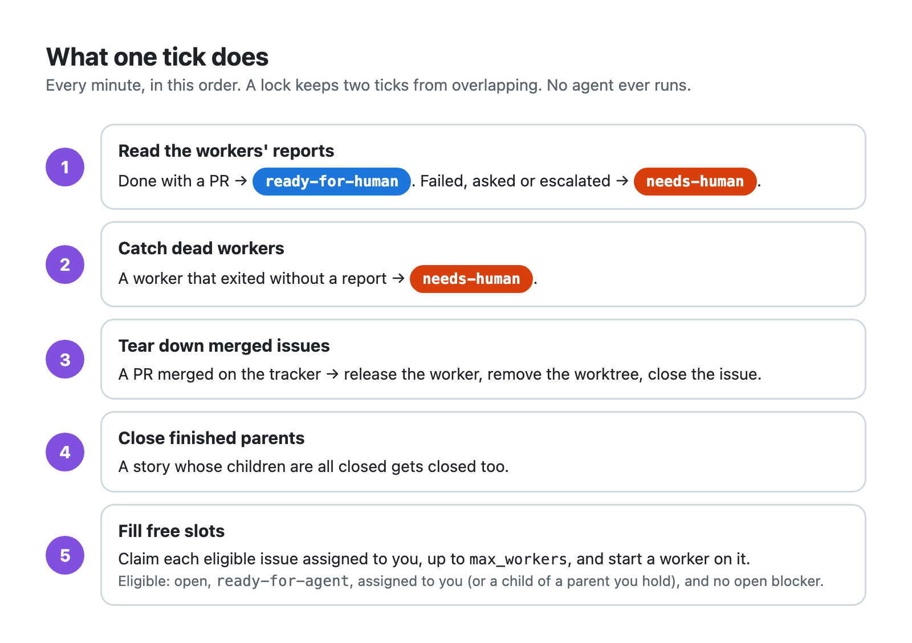
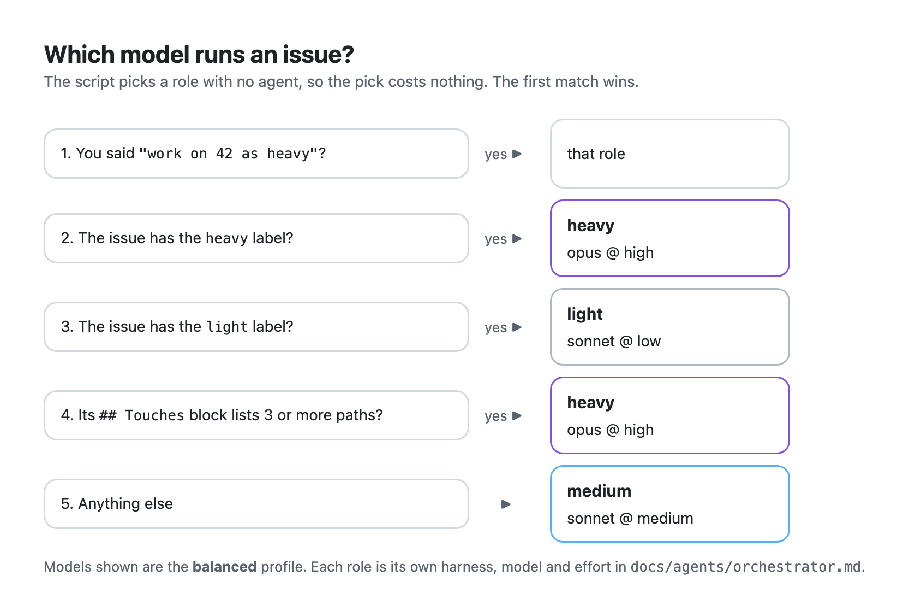

# orchestrator-skills

Label an issue, assign it to yourself, and an agent ships a PR for it. This Claude Code
plugin runs agent workers on your tracker's `ready-for-agent` issues. Each worker gets its own worktree and runs on
the harness and model that fit the job. You review the PR, and you say when to merge.



**In one minute:**

1. You label an issue `ready-for-agent` and assign it to yourself.
2. Within a minute the tick claims it and starts a worker in its own worktree.
3. The worker builds it and opens a PR.
4. You review the PR and say "merge 42". The worker and its worktree go away, and the
   issue closes.

A worker that gets stuck stops, comments its question on the issue and waits for you.

## Why use it

- **Waiting costs nothing.** An orca automation checks the workers once a minute, and that
  check runs as a precheck that never starts an agent. No session polls, and no tokens burn
  while the workers work. Your own session answers a verb and goes idle.
- **Your session stays yours.** "work on 42" returns at once. You keep talking about
  something else while three workers build three issues in parallel.
- **The right model for each issue, picked with no agent.** Each issue runs on a heavy,
  medium or light role, and each role is its own harness, model and effort. A label or the
  issue's `## Touches` count picks the role, so a one-line fix does not pay for your
  strongest model.
- **Any of five agent CLIs:** claude, codex, cursor, pi and copilot. Mix them per role, for
  example opus for heavy work and codex for light work.
- **Your tracker is the dashboard.** GitHub, GitLab or local markdown. An issue's state is
  one label on the tracker, and nothing else. There is no state file to drift and no
  database. A crash loses nothing, and the next tick picks up where the last one stopped.
- **A stuck worker stops and asks.** A worker that fails, gives up or asks a question moves
  its issue to `needs-human`, with its own words as a comment. Nothing re-prompts it into a
  loop. You answer on the issue, relabel it, and a fresh worker resumes in the same
  worktree.
- **A whole story at once.** Label each child of a story, and each one starts as soon as
  nothing blocks it, so the story runs in dependency order. Label the parent too, and the
  tick closes it when the last child closes.
- **You stay in charge.** You decide what is ready, you review every PR, and nothing merges
  until you say "merge N" or merge it on the tracker yourself.
- **Small.** One TypeScript script with no runtime dependency, two skills, five ADRs.

## Install

You need:

- Claude Code, for the orchestrator session.
- The Orca app, which ships the `orca` CLI. The workers and the tick run in Orca.
- Node 22.18 or later.
- `gh` for a GitHub tracker, or `glab` for GitLab. A local markdown tracker needs neither.

Setup checks each of these and installs what it can.

Install the plugin from your shell:

```bash
claude plugin marketplace add wagnersza/orchestrator-skills
claude plugin install orchestrator-skills@wsza
```

Or from inside Claude Code:

```
/plugin marketplace add wagnersza/orchestrator-skills
/plugin install orchestrator-skills@wsza
```

## Set up a repo

Run setup once per repo. A re-run is always safe: it keeps what exists and adds only what
is missing.

1. **Open the repo in Orca**, and start Claude Code in an Orca terminal, in the repo's main
   checkout. Setup creates an orca Run, and orca accepts that only from an Orca terminal.
2. **Say "set up the orchestrator".** The `orchestrator-setup` skill asks one question at a
   time, each with a recommended answer:
   - **The tracker.** It reads `docs/agents/issue-tracker.md`. If that file is missing, it
     asks you to run `/setup-matt-pocock-skills` first.
   - **A cost profile**, which fills all three roles at once:

     | Profile | heavy | medium | light |
     |---|---|---|---|
     | **balanced** (recommended) | opus @ high | sonnet @ medium | sonnet @ low |
     | **economy** | sonnet @ high | sonnet @ low | haiku @ low |
     | **quality** | opus @ xhigh | opus @ high | sonnet @ medium |

     Then you can change the harness, model or effort of any one role.
   - **`max_workers`**, how many workers run at once. The default is 3.
   - **The base branch** each worktree starts from and each PR targets.
3. **Setup installs the rest.** It installs and checks the tracker CLI and each harness CLI
   the roles name. It installs the mattpocock skills each worker uses (`implement`, `tdd`,
   `code-review`, `diagnosing-bugs` and `pr`) into every one of those harnesses. A harness
   that needs a login gets the exact command to run.
4. **Setup writes the config and starts the loop.** It writes `docs/agents/orchestrator.md`,
   then runs the script's `install`. That creates the state labels, the orca Run, the
   `orchestrator-tick` automation and one proof tick. The install ends with
   `the precheck works` when the loop is live.

This repo's own config is [`docs/agents/orchestrator.md`](docs/agents/orchestrator.md).
Edit its JSON block by hand, or re-run setup to change it.

## Use it

Label an issue `ready-for-agent`, then talk to your Claude session, or assign the issue to
yourself and let the tick take it:

| Say | What happens |
|---|---|
| "work on 42" | Claims #42 now and starts its worker. On a parent, starts each eligible child. |
| "status" | The claimed issues with their state, role, harness and PR, then the ready queue, then why each other issue waits. |
| "merge 42" | Merges the PR of a `ready-for-human` issue, then removes its worker and worktree and closes it. |
| "set up the orchestrator" | Runs setup again. |

You can also say nothing: the next tick claims each eligible issue that is assigned to
you, up to `max_workers`. Assign a parent, and the tick runs each of its children with no
assignee of their own. An unassigned issue waits, so the `ready-for-agent` issues that
`to-tickets` and `to-spec` file start nothing until you assign them
([ADR 0006](orchestrator/docs/adr/0006-the-tick-takes-only-what-is-assigned-to-me.md)).

An issue moves through four state labels, and only the script writes them:

| Label | Means | Who moves it on |
|---|---|---|
| `ready-for-agent` | Ready to start. | "work on N" claims it, or the tick once it is assigned to you. |
| `in-progress` | A worker is on it. | The worker's report. |
| `ready-for-human` | A PR is open for your review. | You: "merge N", or a merge on the tracker. |
| `needs-human` | The worker failed, asked or died. Its comment says why. | You: answer on the issue, then relabel it `ready-for-agent`. |

Add the `heavy` or `light` label to an issue to pick its role, or say "work on 42 as heavy".

`node scripts/orchestrator.ts status` prints the same view as "status". It lists the live
issues first, each with its state, role, harness and PR. Then it lists the ready queue, the
issues the next tick would claim. Last come the issues the tick waits on, each with the
reason, such as an open blocker or no assignee.

## How it works

There are four parts, and each one does one job:

- **You** decide what is ready, review each PR and say when to merge.
- **The orchestrator session** is your Claude Code session. It turns each verb you say into
  one call to the script, relays the result and goes idle. It never writes code.
- **The script**, `scripts/orchestrator.ts`, does all the bookkeeping. It claims issues,
  starts workers, moves state labels and tears down merged work. It is plain code, so it
  costs no tokens.
- **The workers** do the code, one agent per issue, each in its own orca worktree.

The tracker holds every bit of state, so nothing else can drift out of step with it.

### The life of an issue



Each issue carries exactly one state label. Look at the label and you know where the issue
is. A crash loses nothing, because the next tick reads the labels and carries on
([ADR 0003](orchestrator/docs/adr/0003-state-labels-are-the-only-state.md)).

### The tick

The `orchestrator-tick` automation runs the script's `tick` once a minute, as an orca
precheck. The precheck always exits non-zero, so the automation's agent never starts and
waiting costs nothing
([ADR 0001](orchestrator/docs/adr/0001-the-precheck-is-the-whole-tick.md)).



The workers report through one orca Run, so the tick reads "done", "failed" and "I have a
question" straight from orca
([ADR 0002](orchestrator/docs/adr/0002-orca-orchestration-is-the-done-and-stuck-signal.md)).

### What a worker does

Each worker gets a short prompt with these steps:

1. Read the issue and every comment on it.
2. Run the `implement` skill on it.
3. Commit in slices, one logical change per commit.
4. Open a PR with the `pr` skill.
5. Never touch a state label, and never merge.
6. When blocked on a decision only a human can make, ask through orca and stop.

A resumed worker is told that it is resuming. It reads the latest comments first, because
they hold your answer.

### Which model runs an issue



The pick is plain code, so you can predict it before the issue starts
([ADR 0005](orchestrator/docs/adr/0005-the-role-is-picked-deterministically.md)). To
change it, add a label or say "work on 42 as light".

### Where the code lives

```
orchestrator/            the orchestrator skill, its glossary and ADRs
orchestrator-setup/      the setup skill and the config template
scripts/orchestrator.ts  install · tick · start · status · merge
scripts/harnesses.ts     how each harness starts
scripts/trackers/        github · gitlab · local
```

The terms are in [`orchestrator/CONTEXT.md`](orchestrator/CONTEXT.md). The decisions the
loop rests on are in [`orchestrator/docs/adr/`](orchestrator/docs/adr/). `make quick`
runs the typecheck and the test suite.

The diagrams are HTML pages in [`docs/images/src/`](docs/images/src/), and
`docs/images/render.sh` renders them to PNG with headless Chrome.
